# 🏥 Sistem Antrean & Informasi Poliklinik Umum
### **Klinik Pratama Sehat Utama**

Aplikasi sistem antrean poliklinik terintegrasi, pendaftaran pasien mandiri, triase medis darurat, pemanggilan antrean dokter, layar informasi TV ruang tunggu, dan administrasi klinik berbasis **Next.js 14 (App Router)**, **TypeScript**, dan **Tailwind CSS**. Didesain dengan standar ergonomi medis sesuai **Verdana Health Design System**.

---

## 📸 Galeri Screenshot Aplikasi

Berikut adalah dokumentasi antarmuka aplikasi Klinik Pratama Sehat Utama berdasarkan setiap modul dan peran pengguna:

### 1. Modul Pasien & Publik
| Halaman Masuk Pasien | Pendaftaran Akun Pasien Baru |
| :---: | :---: |
| 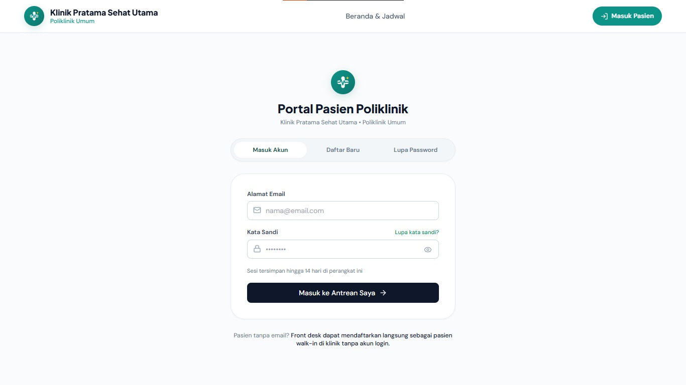 | 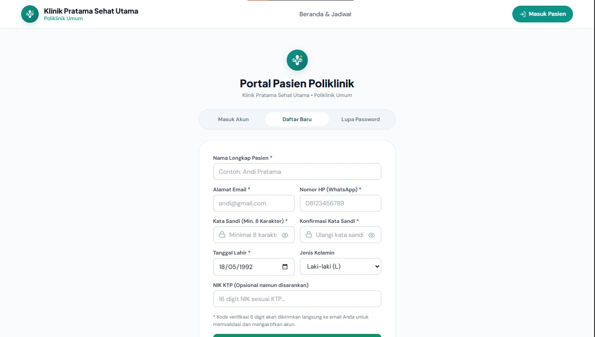 |
| *Autentikasi aman berbasis Nomor HP & OTP* | *Pendaftaran akun baru dengan verifikasi email OTP* |

| Pemulihan Kata Sandi (Lupa Password) | Portal Pasien Mandiri |
| :---: | :---: |
| 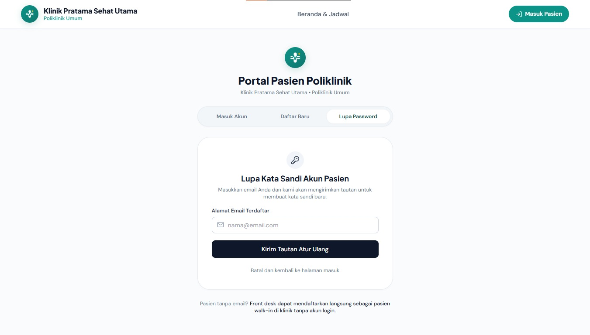 | 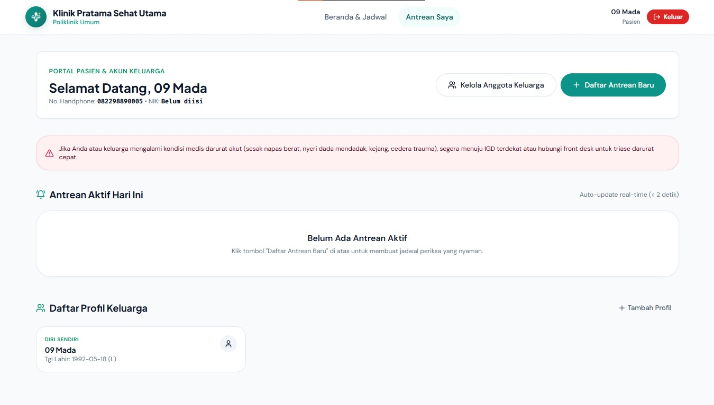 |
| *Reset password mandiri dengan kode verifikasi OTP* | *Kelola profil keluarga & pantau antrean aktif real-time* |

| Pendaftaran Antrean & Jadwal Dokter |
| :---: |
| 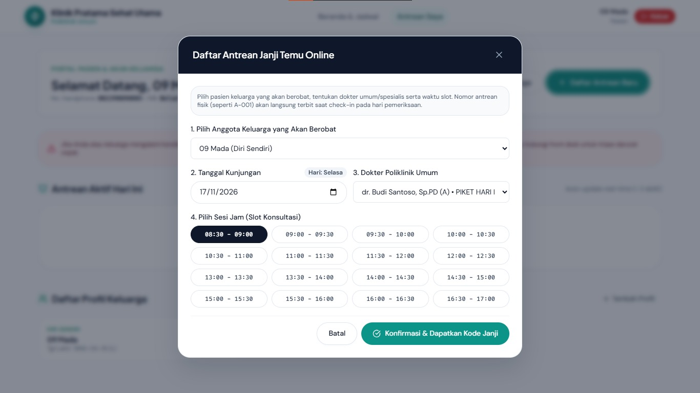 |
| *Pilih anggota keluarga, poli tujuan, dokter umum/spesialis, serta slot waktu* |

---

### 2. Modul Staf Klinis & Tenaga Medis
| Portal Masuk Staf Medis | Meja Resepsionis / Front Desk |
| :---: | :---: |
| 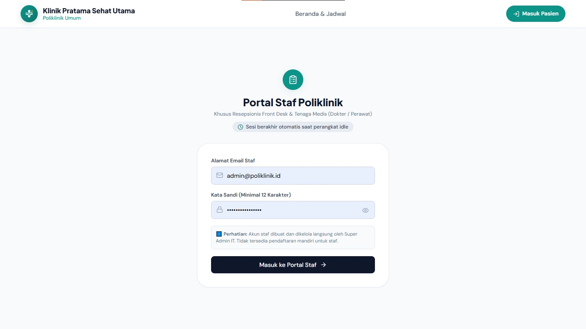 | 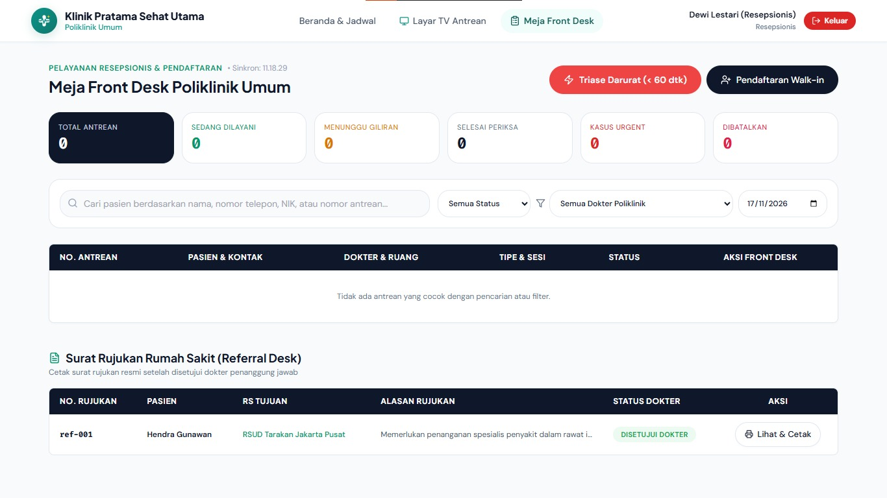 |
| *Akses terenkripsi bagi dokter, perawat, & resepsionis* | *Check-in pasien, pendaftaran walk-in, & triase darurat < 60 detik* |

| Ruang Periksa Klinis Dokter & Perawat | Layar TV Display Ruang Tunggu |
| :---: | :---: |
| 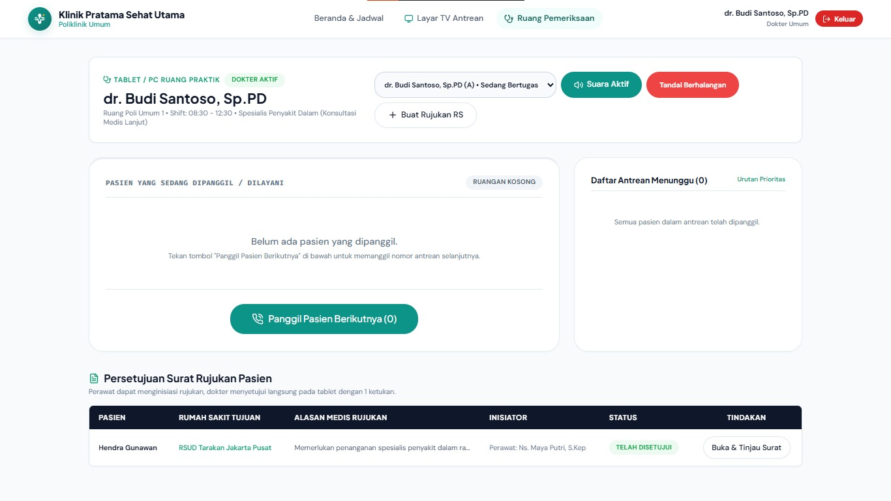 | 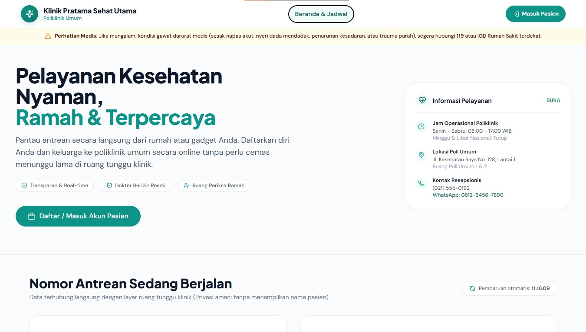 |
| *Panggil (Call), periksa, diagnosa medis, & terbitkan surat rujukan RS* | *Tampilan 1080p fullscreen nomor antrean aktif dilengkapi audio bell otomatis* |

---

### 3. Modul Manajemen & Super Admin IT
| Portal Masuk Super Admin | Dashboard Super Admin IT |
| :---: | :---: |
| 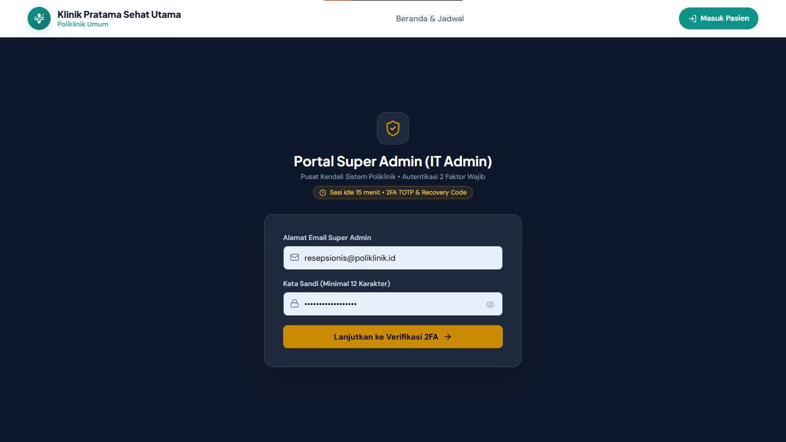 | 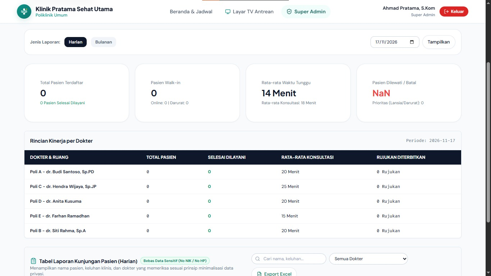 |
| *Gerbang otorisasi level tinggi dengan kunci rahasia* | *Jadwal dokter, audit log keamanan medis, backup database, & laporan Excel/PDF* |

---

## 🌟 Fitur Utama Sistem

1. **Portal Pasien & Akun Keluarga**:
   - Pendaftaran akun terverifikasi OTP via Gmail SMTP asli.
   - Manajemen multi-anggota keluarga (anak, pasangan, lansia) dalam satu akun.
   - Booking antrean online sesuai jadwal dokter piket.
   - Cetak tiket antrean mandiri & pantau nomor berjalan tanpa menunggu lama di klinik.

2. **Meja Resepsionis & Triase Darurat (< 60 Detik)**:
   - Pendaftaran pasien walk-in tanpa akun dengan penerbitan ID sementara (`TMP-xxxx`).
   - Fitur **Triase Cepat Medis**: penandaan pasien gawat darurat / prioritas lansia untuk memotong antrean secara legal.
   - Cetak slip tiket fisik printer termal.

3. **Ruang Klinis Dokter & Perawat**:
   - Antarmuka pemanggilan suara antrean loket periksa.
   - Penanganan pasien berhalangan: *Recall* hingga 3x otomatis ditandai *Skipped* agar antrean tidak macet.
   - Rekam diagnosis klinis ICD-10 & riwayat obat.
   - Penerbitan resmi **Surat Rujukan Rumah Sakit (SPK/Rujukan)** lengkap dengan kop instansi dan validasi DPJP.

4. **Layar Display TV Ruang Tunggu (`/tv`)**:
   - Dirancang khusus layar resolusi 1080p/768p ruang tunggu.
   - Dilengkapi synthesizer suara panggilan antrean (*Audio Chime & Speech Announcement*).
   - Indikator status jaringan real-time & proteksi banner otomatis saat koneksi terputus.
   - Opsi Mode Gelap (*Dark Mode*) untuk kenyamanan visual pencahayaan ruangan.

5. **Keamanan & Tata Kelola IT (Super Admin)**:
   - **Role-Based Access Control (RBAC)** dan *Auto-Idle Logout* (sesi otomatis tertutup jika perangkat staf ditinggalkan).
   - Penggabungan akun ganda (*Duplicate Merge*) berbasis NIK/No. Rekam Medis.
   - Enkripsi backup database harian (AES-256) dan uji pemulihan (*test restore*).
   - Ekspor rekapitulasi antrean ke format **Excel (`.xlsx`)** dan **PDF**.

---

## 🔑 Kredensial Uji Coba Demonstrasi

Gunakan akun demonstrasi berikut untuk mencoba seluruh peran yang tersedia pada halaman login staf (`/staff`), pasien (`/login`), atau admin (`/admin`):

| Peran Pengguna | Username / No. HP | PIN / Password | Akses Halaman |
| :--- | :--- | :--- | :--- |
| **Resepsionis (Front Desk)** | `resepsionis` | `123456` | `/petugas` |
| **Dokter Umum (Poli A)** | `dr_budi` | `123456` | `/klinis` |
| **Dokter Spesialis Anak (Poli B)** | `dr_siti` | `123456` | `/klinis` |
| **Perawat Poliklinik** | `perawat_maya` | `123456` | `/klinis` |
| **Super Admin IT** | `admin` | `123456` | `/admin` |
| **Pasien Terdaftar** | `081234567890` | `123456` | `/pasien` |

---

## ⚙️ Panduan Instalasi (Installation Guide)

Ikuti langkah-langkah berikut untuk menjalankan sistem di lingkungan komputer lokal Anda:

### 1. Prasyarat Sistem
Pastikan perangkat Anda telah terpasang:
- **Node.js** versi 18.18.0 atau yang lebih baru ([Download Node.js](https://nodejs.org/))
- **npm** (bawaan Node.js) atau **pnpm** / **yarn**
- Git

### 2. Clone Repository
```bash
git clone https://github.com/username/projectPolyclinic.git
cd projectPolyclinic
```

### 3. Pasang Seluruh Dependensi
Jalankan perintah berikut untuk mengunduh seluruh dependensi paket:
```bash
npm install
```

### 4. Konfigurasi Environment Variables
Salin berkas `.env.example` menjadi `.env.local`:
```bash
cp .env.example .env.local
```

Buka `.env.local` menggunakan text editor (VS Code, Notepad, dll.) dan sesuaikan variabel kunci:

```env
# 1. Supabase Database Sync (Opsional untuk deployment cloud / multi-perangkat)
NEXT_PUBLIC_SUPABASE_URL=https://your-project-id.supabase.co
NEXT_PUBLIC_SUPABASE_ANON_KEY=your-supabase-anon-key
SUPABASE_SERVICE_ROLE_KEY=your-supabase-service-role-secret-key

# 2. Gatekeeper Admin Key
ADMIN_SECRET_KEY=sehat-utama-it-2026

# 3. Kunci Enkripsi Backup
BACKUP_ENCRYPTION_KEY=sehat-utama-backup-secret-key-2026

# 4. Pengiriman Email OTP via Gmail SMTP (Nodemailer)
EMAIL_SERVER_HOST=smtp.gmail.com
EMAIL_SERVER_PORT=465
EMAIL_SERVER_SECURE=true
EMAIL_SERVER_USER=email-anda@gmail.com
EMAIL_SERVER_PASSWORD=your-16-character-app-password
EMAIL_FROM="Klinik Pratama Sehat Utama" <email-anda@gmail.com>
```

> **Tips Google App Password:**
> Untuk mendapatkan `EMAIL_SERVER_PASSWORD`, aktifkan 2-Step Verification pada akun Google Anda, lalu buat *App Password* di menu **Keamanan Akun Google -> Sandi Aplikasi**.

### 5. Menjalankan Aplikasi (Development Mode)
```bash
npm run dev
```
Buka browser dan akses:
- **Website Publik & Pasien**: [http://localhost:3000](http://localhost:3000)
- **Portal Staf Medis**: [http://localhost:3000/staff](http://localhost:3000/staff)
- **Layar TV Antrean**: [http://localhost:3000/tv](http://localhost:3000/tv)
- **Portal Admin IT**: [http://localhost:3000/admin](http://localhost:3000/admin)

### 6. Build untuk Lingkungan Produksi
Untuk menguji performa produksi (*production build*):
```bash
npm run build
npm start
```

---

## 📖 Panduan Penggunaan (User Manual)

### 🩺 Alur 1: Pasien (Pendaftaran Mandiri & Cek Antrean)
1. Buka halaman utama [http://localhost:3000](http://localhost:3000) dan klik **Masuk Pasien** di pojok kanan atas.
2. Jika belum memiliki akun, klik tab **Daftar Akun**, lengkapi data diri, dan masukkan kode verifikasi OTP yang dikirimkan ke email Anda.
3. Setelah masuk ke **Portal Pasien** (`/pasien`):
   - Tambahkan profil anggota keluarga (opsional).
   - Klik **Daftar Antrean Baru**, pilih dokter tujuan dan tanggal pemeriksaan.
   - Tiket antrean online akan terbit secara otomatis.
   - Pada hari kunjungan, tunjukkan tiket ke resepsionis untuk melakukan konfirmasi *Check-In*.

---

### 📋 Alur 2: Resepsionis Front Desk (Pelayanan Loket & Triase)
1. Buka [http://localhost:3000/staff](http://localhost:3000/staff) dan login menggunakan akun `resepsionis`.
2. Pada halaman **Meja Resepsionis** (`/petugas`):
   - **Check-in Pasien Online**: Cari nama pasien yang sudah booking online lalu klik tombol centang *Check-in* untuk mengaktifkan antrean fisiknya.
   - **Pendaftaran Walk-In**: Jika pasien datang langsung tanpa mendaftar online, klik tombol **Daftar Pasien Walk-In**.
   - **Triase Darurat / Lansia**: Jika pasien membutuhkan penanganan cepat (misal: sesak nafas, pendarahan, nyeri dada, atau lansia > 65 tahun), klik **Triase Gawat Darurat**, pilih kategori kegawatan, dan sistem akan otomatis menempatkan nomor antrean di urutan teratas prioritas dokter.
   - **Cetak Tiket**: Klik tombol printer pada antrean untuk mencetak struk tiket fisik ke printer kasir/termal.

---

### 👨‍⚕️ Alur 3: Dokter & Tenaga Medis (Pemeriksaan & Rujukan)
1. Buka [http://localhost:3000/staff](http://localhost:3000/staff) dan login menggunakan akun dokter (misal: `dr_budi`).
2. Masuk ke halaman **Ruang Periksa Klinis** (`/klinis`):
   - Klik tombol **Panggil Antrean Berikutnya** (*Call*) untuk memanggil pasien. Layar TV ruang tunggu akan menyuarakan nomor antrean tersebut secara otomatis.
   - Jika pasien belum hadir, klik tombol **Panggil Ulang** (*Recall*).
   - Saat pasien memasuki ruang periksa, klik **Mulai Konsultasi**.
   - Isi diagnosa keluhan, resep, atau catatan tindakan medis.
   - **Penerbitan Surat Rujukan**: Jika kondisi pasien membutuhkan penanganan spesialis lanjutan di rumah sakit, klik **Buat Surat Rujukan RS**, pilih rumah sakit tujuan dan unit spesialis, lalu cetak surat formal berstandar DPJP.
   - Klik tombol **Selesaikan Pemeriksaan** (*Finish*) untuk memanggil antrean berikutnya.

---

### 📺 Alur 4: Pengoperasian Layar TV Ruang Tunggu
1. Buka [http://localhost:3000/tv](http://localhost:3000/tv) pada komputer/mini PC yang terhubung ke monitor TV ruang tunggu klinik.
2. Tekan tombol **Layar Penuh (F11)** atau klik ikon *Maximize* di sudut atas.
3. Fitur yang tersedia:
   - Suara bel dan pembacaan nomor antrean otomatis saat dokter menekan tombol panggil.
   - Toggle sakelar **Tema Gelap / Terang** untuk menyesuaikan pencahayaan ruangan tunggu.
   - Banner darurat dan informasi edukasi kesehatan yang berjalan di bagian bawah layar (*running text*).

---

### 🛡️ Alur 5: Super Admin IT (Manajemen & Pemeliharaan)
1. Buka [http://localhost:3000/admin](http://localhost:3000/admin) dan login dengan akun `admin`.
2. Menu operasional admin meliputi:
   - **Manajemen Dokter & Jadwal**: Mengatur jadwal piket dokter harian, mengganti status cuti/izin dokter, dan mengaktifkan dokter pengganti.
   - **Penggabungan Duplikat (Duplicate Merge)**: Mengidentifikasi akun pasien ganda (nama dan tanggal lahir mirip) dan menggabungkannya ke satu rekam medis utama.
   - **Backup & Restore Database**: Mengunduh cadangan data terenkripsi AES-256 dan melakukan tes pemulihan berkala.
   - **Laporan & Ekspor**: Mengunduh rekapitulasi data kunjungan poliklinik ke dalam format spreadsheet **Excel (`.xlsx`)** atau laporan cetak **PDF**.

---

## 🏛️ Arsitektur & Teknologi

- **Framework**: [Next.js 14](https://nextjs.org/) (React 18, App Router)
- **Bahasa Pemrograman**: [TypeScript](https://www.typescriptlang.org/)
- **Styling UI**: [Tailwind CSS](https://tailwindcss.com/) & [Lucide Icons](https://lucide.dev/)
- **Database & Penyimpanan**: 
  - Mode Lokal: JSON Database Engine berbasis file terisolasi (`data/db.json`)
  - Mode Cloud: [Supabase](https://supabase.com/) PostgreSQL & Realtime Channel
- **Autentikasi**: Custom HTTP-only session cookie dengan Role-Based Access Control (RBAC) & proteksi CSRF
- **Layanan Email**: [Nodemailer](https://nodemailer.com/) (SMTP Gmail OTP & notifikasi)
- **Ekspor Dokumen**: [jsPDF](https://github.com/parallax/jsPDF) & [SheetJS (xlsx)](https://sheetjs.com/)

---

## 📜 Lisensi & Hak Cipta

Dikembangkan untuk **Klinik Pratama Sehat Utama**  
Hak Cipta © 2026. Seluruh hak cipta dilindungi undang-undang.  
*Sistem Informasi Pelayanan Kesehatan & Antrean Terpadu.*
